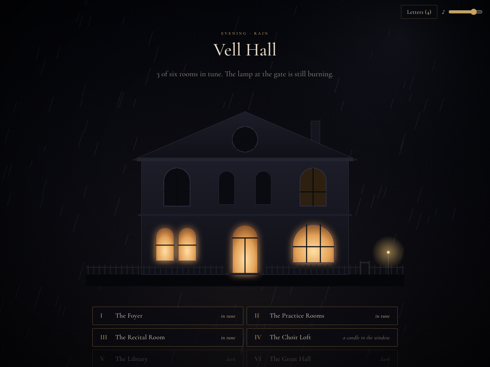
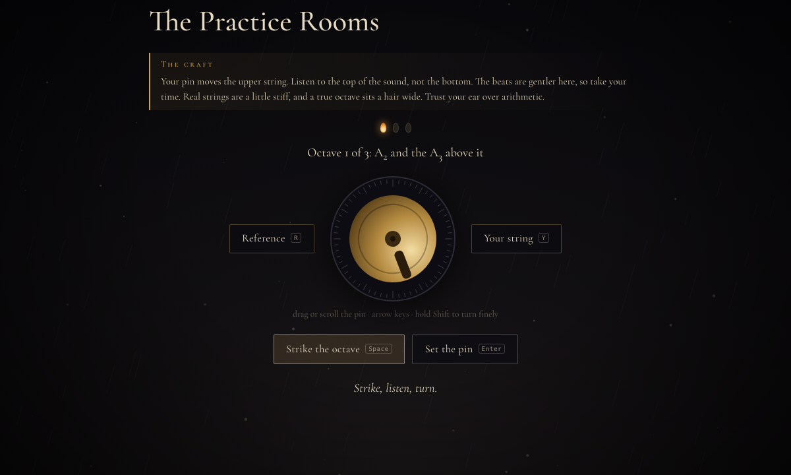
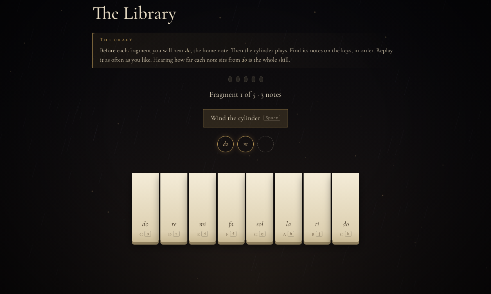
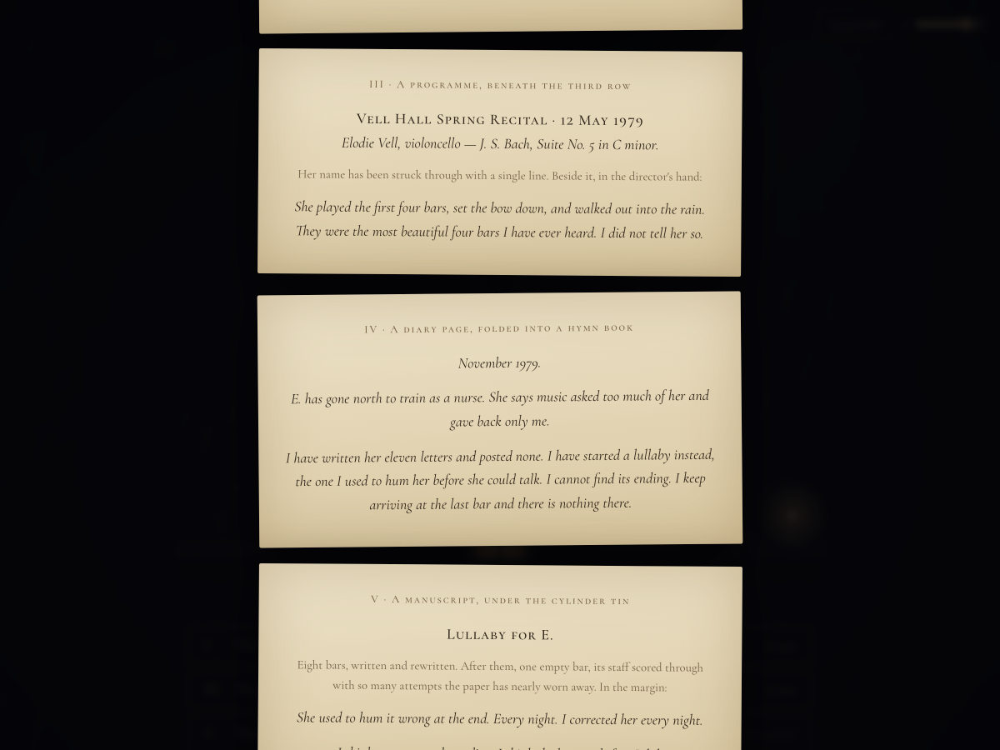
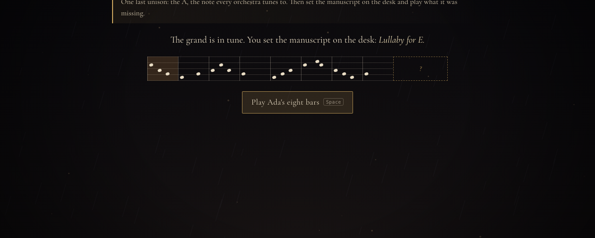

# The Tuner of Vell Hall

**A quiet, melancholic story game that trains your ear.**

Vell Hall, a music conservatory, has been silent for forty years. At the end of the month it will be demolished. Elodie Vell, the elderly daughter of its last director, has hired you to tune it once more. She can no longer manage the stairs, so she will listen from the gate.

You get a key under a stone and a letter. Inside are six rooms, every instrument has drifted out of tune, and in a manuscript somewhere upstairs there is a lullaby with an empty last bar.



---

## Play

The Tuner of Vell Hall is a single HTML file with no build step, no install and no audio files.

- **Locally:** download or clone this repo and open `index.html` in a desktop browser.
- **Online:** enable GitHub Pages for this repo (Settings → Pages → deploy from branch, root folder) and open the published URL.

Use headphones; the tuning rooms depend on them. A full play-through takes about an hour.

## What it is

Each room is a chapter, and each chapter teaches one real ear-training skill. Finishing a room fills it with light and gives you the next piece of the story: a card, a pencil note, a programme, a diary page, a manuscript.

| Room | Instrument | Skill |
|---|---|---|
| I · The Foyer | an upright piano | **Unisons.** Tune two strings to the same pitch by listening for *beats*, the slow wavering two nearly matching strings make. |
| II · The Practice Rooms | six small pianos | **Octaves.** Listen *inside* the lower note for the overtone the upper string has to match. |
| III · The Recital Room | a stage piano | **Intervals.** Name the distance between two notes, with a familiar song for each one. |
| IV · The Choir Loft | a reed organ | **Chord quality.** Tell major, minor, diminished and augmented apart. |
| V · The Library | a phonograph | **Melodic dictation.** Write down a child's humming from a wax cylinder. |
| VI · The Great Hall | the concert grand | **All of it.** One last unison, then play the ending the lullaby never had. |



### How the training works

- **No meters, only ears.** The tuning pin has no zero mark and its position is randomized every round, so you can't tune by eye. When you set the pin too early, the game tells you roughly how many beats per second are left, which is exactly what a piano tuner listens for.
- **Real piano physics.** The synthesized strings are slightly stiff, so their upper partials (overtones) run a little sharp, as on a real piano. That means a beatless octave sits about one cent wide, not at a perfect 2:1 ratio. The game checks your octave against the stretched target.
- **Gradually unlocked material.** Intervals start with the major third, perfect fifth and octave. The perfect fourth and minor third join after 4 correct answers, and the major sixth and minor second after 8. Chords start with major and minor, add diminished at 4 and augmented at 7. Each new option is introduced with an example first.
- **Mistakes teach.** A wrong interval or chord shows the right answer and lets you hear yours beside it. In dictation, the game tells you how many notes you had right, gives you the first note after 3 misses, and the melody's up-and-down shape after 6.
- **Optional visual crutch.** After two misses in a tuning room you can choose *Show me the string*, which draws the sound's volume envelope live so you can *see* the beats. Use it to learn what to listen for, then stop using it.



### Tolerances

| Room | Rounds | Must land within |
|---|---|---|
| Foyer (unison) | 3 strings | 3 → 2.5 → 2 cents |
| Practice Rooms (octave) | 3 octaves | 3.5 → 3 → 2.6 cents |
| Recital Room | 12 correct intervals | — |
| Choir Loft | 10 correct chords | — |
| Library | 5 fragments, 3 to 7 notes | every note in order |
| Great Hall | 1 unison + the ending | 1.6 cents, then 7 notes |

A cent is a hundredth of a semitone. Two cents off at A3 is about one beat every four seconds.

## The sound

Everything is synthesized live in the browser with the Web Audio API:

- **Piano:** additive synthesis with nine inharmonic partials per string, separate decay rates per partial, and a filtered noise "hammer"
- **Reed organ:** detuned sawtooth voices with vibrato, shaped through vocal-style formant filters
- **The child's humming:** a scooped, vibrato-laden voice behind a band-limited "phonograph" filter, with wax-cylinder hiss and crackle
- **Music box and chimes:** inharmonic bell partials
- **The building:** rain that sounds muffled once you're indoors, wind, a low room tone in each room's key, door creaks, and paper sounds
- **The hall itself:** a generated convolution reverb that gets darker as it decays

Once rooms are in tune, the hall outside sometimes plays fragments of the lullaby back to you from the rooms you've restored. The ambience drops away during exercises so you can hear clearly.

## Controls

| Where | Input | Action |
|---|---|---|
| Tuning | drag or scroll the pin | turn the tuning pin (hold <kbd>Shift</kbd> to turn finely) |
| | <kbd>↑</kbd> <kbd>↓</kbd> <kbd>←</kbd> <kbd>→</kbd> | turn ½ cent (with <kbd>Shift</kbd>: ⅒ cent) |
| | <kbd>Space</kbd> | strike both strings |
| | <kbd>R</kbd> / <kbd>Y</kbd> | strike only the reference string / only yours |
| | <kbd>Enter</kbd> | set the pin |
| Intervals & chords | <kbd>1</kbd>–<kbd>7</kbd> | choose an answer |
| | <kbd>Space</kbd> | hear it again |
| | <kbd>Enter</kbd> | next question (after a wrong answer) |
| Dictation | <kbd>A</kbd> <kbd>S</kbd> <kbd>D</kbd> <kbd>F</kbd> <kbd>G</kbd> <kbd>H</kbd> <kbd>J</kbd> <kbd>K</kbd> or <kbd>1</kbd>–<kbd>8</kbd> | play do re mi fa sol la ti do |
| | <kbd>Space</kbd> | wind the cylinder (in the Great Hall: replay Ada's bars) |
| | <kbd>L</kbd> | in the Great Hall: wind the cylinder |
| Anywhere | <kbd>Enter</kbd> | begin a room / return to the hall |
| | <kbd>Esc</kbd> | close your letters |

Everything also works with a mouse or touch. In the room narration, click the text to make it appear faster.

## Saving

Progress is saved automatically in your browser's `localStorage` under the key `vellhall.v1`: the rooms you've finished, whether you've seen the ending, and your volume. To start over, choose **Begin again** on the title screen and click it a second time to confirm.

Saves belong to one browser and one device, and clearing site data removes them. Rooms you've already finished stay open for practice.



## Story spoilers

<details>
<summary>What you find in each room (open only after you've played)</summary>

- **The Foyer:** a 1962 welcome card from Ada Vell, the director: *"Be kind to the instruments; they remember everything."* On the back, a child has signed it as Assistant Director, age 6.
- **The Practice Rooms:** eleven years of tally marks on the frame of Room 4, which was Elodie's practice room. *"Mother says one more year."* Underneath, in Ada's hand: *"You don't have to be good. You only have to be here."*
- **The Recital Room:** the programme from May 1979. Elodie played four bars of Bach, put down the bow, and walked out into the rain. Ada thought they were the most beautiful four bars she had ever heard, and never told her.
- **The Choir Loft:** Ada's diary. Elodie has left to become a nurse. Ada wrote eleven letters and posted none, and started a lullaby she can't finish.
- **The Library:** a wax cylinder of six-year-old Elodie humming that lullaby, and Ada's manuscript with its empty last bar. *"She used to hum it wrong at the end… I think wrong was the ending."* The final dictation fragment is that wrong ending.
- **The Great Hall:** you play Ada's eight bars, then Elodie's ending. The lamp at the gate lifts and stays lifted until the sound is gone. In the morning there is one line under the door.

</details>



## Technical notes

- One self-contained `index.html` (HTML, CSS and vanilla JS) of about 74 KB, with no dependencies and no build.
- The tuning pin changes the `detune` of every partial of the ringing string live, so you hear the beats speed up or slow down as you turn.
- Long passages such as the finale go through a small lookahead scheduler, so nodes are created just in time rather than hundreds at once.
- The *Show me the string* view is an `AnalyserNode` that only listens to the strings being tuned, drawn as an RMS (volume) envelope on a `<canvas>`.
- The background (rain, moonlight, candle-lit dust motes tinted per room) is a single `<canvas>`. The hall's front is inline SVG.
- Fonts come from Google Fonts (Cormorant Garamond, Cormorant SC). Offline, the game still works with system serif fallbacks.
- It respects `prefers-reduced-motion`. The layout adapts to phones, but the tuning rooms are best with headphones and a keyboard.
- Tested in desktop Chrome. Other modern browsers with Web Audio support should work.

### Project structure

```
VellHall/
├── index.html      # the entire game
├── README.md
└── docs/           # screenshots for this README
    ├── hall.png
    ├── tuning.png
    ├── cylinder.png
    ├── letters.png
    └── manuscript.png
```

## Credits

Fonts: [Cormorant Garamond](https://fonts.google.com/specimen/Cormorant+Garamond) and [Cormorant SC](https://fonts.google.com/specimen/Cormorant+SC) by Christian Thalmann, under the SIL Open Font License.

The songs used as interval reminders are only named, never reproduced. The lullaby, Vell Hall, Ada and Elodie Vell are fictional.

## License

No project license has been specified. This repository does not currently grant a license to reuse, modify, or redistribute the game. The font licenses are noted in Credits above.
